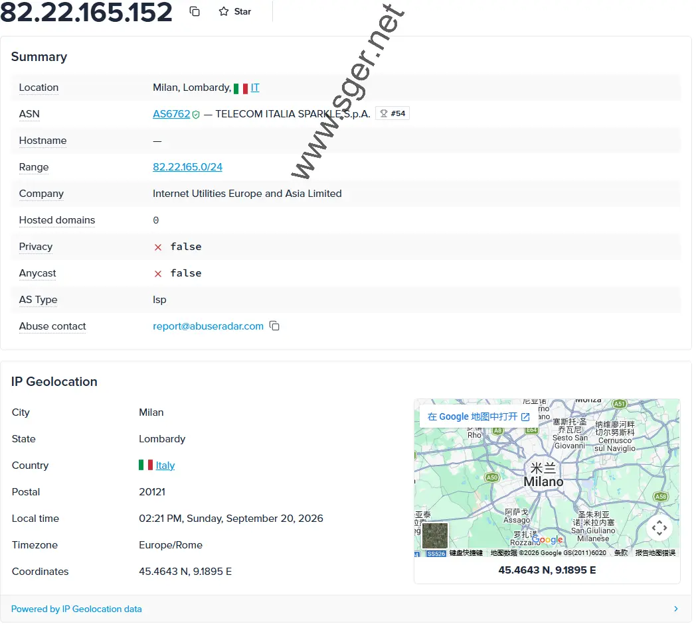
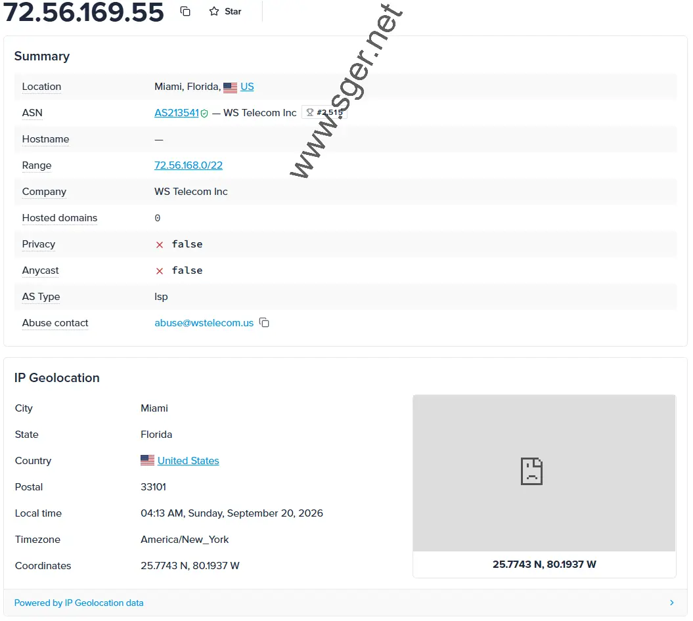
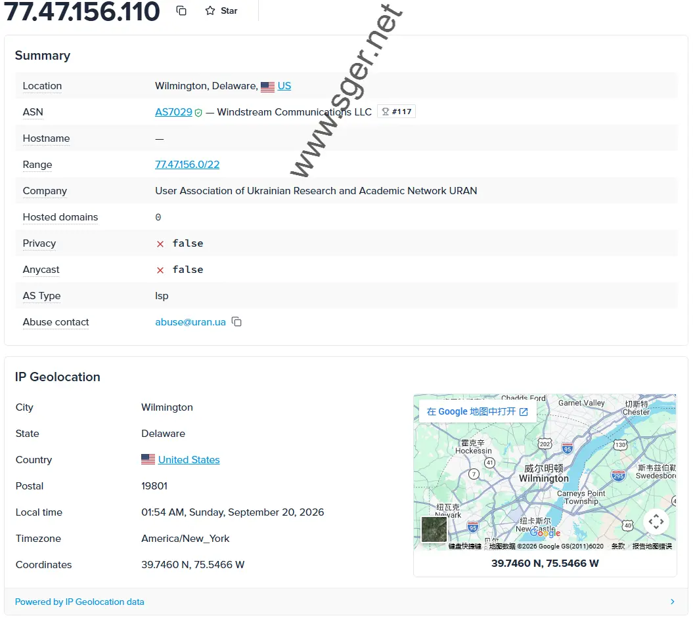

## 住宅IP 是什么

住宅IP代理让你的设备对外呈现为一个真实家庭宽带的出口IP,而不是一眼就能被识别的机房/云服务器IP。不管是管理多个电商账号、做社媒养号,还是做数据采集、价格监控,选对住宅IP类型直接关系到账号安全和采集效率。

这份指南只整理真正付费测试过的几家服务商,不做"堆砌十几家"式的罗列,附带实测截图和完整价格表。

## 先分清楚:静态 ISP 代理 vs 动态住宅代理

一句话记住:**管账号用静态,采数据用动态**。

- 🏠 **固定IP管账号**:电商店铺、社媒养号、薅羊毛类需求 → 选静态ISP代理
- 🔄 **批量采集数据**:爬虫、价格监控、SEO抓取 → 选动态住宅代理
- 💰 **预算有限**:优先看支持单个购买测试的低价方案

## 家宽 / 双ISP 住宅VPS vs 静态ISP代理 vs 动态旋转代理

很多人会把"家宽""双ISP""静态住宅IP"混着说,但三者的交付形态、使用方式和账号安全表现其实差别不小,选错类型可能直接影响风控。

| 对比维度 | 静态ISP代理 | 家宽/双ISP住宅VPS | 动态旋转住宅代理 |
|---|---|---|---|
| 本质 | 代理出口(只换IP) | 完整服务器+住宅IP | 代理出口(每次自动换IP) |
| IP属性 | ISP签发的固定住宅IP | 真实家庭宽带/双ISP认证IP | 真实住宅IP池轮换 |
| 是否固定 | 固定(租期内不变) | 固定(服务器IP不变) | 不固定(按请求/时间轮换) |
| 使用方式 | 浏览器/工具配置代理 | 远程桌面/SSH登录整台机器 | 浏览器/工具配置代理 |
| 适合场景 | 多账号管理、养号 | 需要完整环境、高纯净度运营 | 数据采集、价格监控 |
| 风控表现 | 较好 | 通常最好(更接近真实用户) | 一般(不适合长期登录) |
| 部署门槛 | 低(装个代理插件即可) | 较高(需要会用远程桌面/SSH) | 低(装代理插件即可) |
| 价格参考 | 约$3–15/IP/月 | 通常更高(按配置计费) | 按流量计费 |
| 推荐服务商 | Webshare、Proxy Seller、PrivateProxy、IPBurger | 丽萨主机(LisaHost) | Webshare、Proxy Seller 动态套餐 |

**怎么选?**

- 只需要固定出口管账号 → 静态ISP代理(下方重点推荐)
- 需要完整独立系统+更高纯净度 → 家宽/双ISP住宅VPS
- 批量采集数据 → 动态旋转住宅代理

### 家宽/双ISP住宅VPS:丽萨主机(LisaHost)

专注住宅IP方向的VPS服务商,提供美国家宽、双ISP认证等产品线。适合对IP纯净度要求极高、需要完整独立系统环境的用户,比如跨境电商主号或高价值账号运营——你拿到的是一台真实服务器加住宅IP,而不只是一个代理出口。

价格通常高于普通静态ISP代理,更适合预算充足、追求高纯净度的用户。

👉 [查看丽萨主机套餐](https://lisahost.com/aff.php?aff=1234)

## 亲测推荐:4家住宅IP服务商

以下均为付费实测,支持国内支付方式的已标注。

| 服务商 | 最低价格 | 类型 | 支付方式 | 国内支付 | 适合场景 | 购买入口 |
|---|---|---|---|---|---|---|
| **Webshare** | 静态$6/20IP · 动态$3.5/G | 静态+动态 | VISA、Mastercard、Discover | ✅ Visa | 薅空投、ChatGPT、TikTok、数据采集 | [购买](https://www.sger.net/webshare) |
| **Proxy Seller** | 静态$3/IP · 动态$3.5/G | 静态+动态 | Paypal、VISA、Mastercard、比特币 | ✅ Visa | 薅空投、问卷、ChatGPT、TikTok、数据采集 | [购买](https://www.sger.net/proxy-seller) |
| **PrivateProxy** | 静态$5/IP · 动态$2/G | 静态+动态 | Paypal、VISA、Mastercard、银联 | ✅ 银联 | 薅空投、问卷、ChatGPT、TikTok | [购买](https://www.sger.net/privateproxy) |
| **IPBurger** | 静态$14.41/IP · 动态$5.9/G | 静态+动态 | Paypal、VISA、Mastercard、比特币 | ✅ Visa | 企业级数据采集、薅空投、TikTok | [购买](https://www.sger.net/ipburger) |

### Webshare

有免费机房IP试用,G2评分表现不错。静态住宅IP最低20个起卖,$6/月起;动态住宅IP近期有降价。免费套餐每月赠送10个代理IP和1G流量(注意免费版是机房IP而非住宅IP)。做TikTok建议选Dedicated独享档位。

- **支付方式**:VISA、Mastercard、Discover
- **适合场景**:薅空投、ChatGPT访问、TikTok、数据采集
- **口碑**:G2 评分表现不错,免费机房IP可先试用

*Webshare 美国住宅IP 实测截图*

**静态住宅IP**

| 类型 | 数量 | 月价格 |
|---|---|---|
| Shared | 20个 | $6 |
| Private | 25个 | $24.36 |
| Dedicated | 25个 | $42 |

**动态住宅IP**

| 流量 | 价格 |
|---|---|
| 1G | $3.5/G |
| 10G | $2.75/G |
| 25G | $2.6/G |

👉 [前往 Webshare 购买](https://www.sger.net/webshare)

### IPBurger

成立于2007年,总部美国,属于企业级服务商。IP可精确到城市并可选择ISP运营商,质量属于头部水平,支持30天全额退款,适合对稳定性要求较高的用户。

- **支付方式**:Paypal、VISA、Mastercard、比特币
- **适合场景**:企业级数据采集、薅空投、TikTok
- **口碑**:G2 评分表现不错,支持30天全额退款

**动态住宅IP**

| 月价格 | 流量 | 单G价格 |
|---|---|---|
| $59 | 10G | $5.90 |
| $149 | 30G | $4.97 |

**静态住宅IP**

| 价格 | 覆盖国家 |
|---|---|
| $14.41/IP/月 | 美、英、法、德、加 |

👉 [前往 IPBurger 购买](https://www.sger.net/ipburger)

### PrivateProxy

按代理个数计费,1个起购,$5/月起,无限连接数、无限流量。支持银联支付,比较适合预算有限、刚入门的用户。

- **支付方式**:Paypal、VISA、Mastercard、银联
- **适合场景**:薅空投、问卷、ChatGPT、TikTok
- **口碑**:G2 评分表现不错,无限流量、无限连接数

*PrivateProxy 动态住宅IP 实测截图*

**静态住宅IP**

| 数量 | 月价格 | 连接数 | 流量限制 |
|---|---|---|---|
| 1个 | $5 | 无限 | 无限 |
| 10个 | $50 | 无限 | 无限 |

**动态住宅IP**

| 价格 | 流量 |
|---|---|
| 首单$10 | 10G |
| $50 | 25G |

👉 [前往 PrivateProxy 购买](https://www.sger.net/privateproxy)

### Proxy Seller

价格是这几家里最便宜的一档,提供中文网站,国内不需要额外工具即可直接打开。支持按周/月计费,覆盖21个国家和地区。

- **支付方式**:Paypal、VISA、Mastercard、比特币
- **适合场景**:薅空投、问卷、ChatGPT、TikTok、数据采集
- **口碑**:G2 评分表现不错,价格最低、中文站国内可直连

*Proxy Seller 动态住宅IP 实测截图*

**动态住宅IP**

| 价格 | 流量 | 计费周期 |
|---|---|---|
| $3.5/G | 1G | 按量 |
| $25/月 | 10G | 包月 |

**静态住宅IP(ISP)**

| 价格 | 数量 | 带宽 | 覆盖范围 |
|---|---|---|---|
| $3/IP/月 | 1个 | 1G | 21个国家和地区 |
| $71.25/25个 | 25个 | 1G | 21个国家和地区 |

👉 [前往 Proxy Seller 购买](https://www.sger.net/proxy-seller)

## 快速选择建议

- 薅空投/管账号 → 优先静态IP(IPBurger 或 Webshare Private/Dedicated)
- 做TikTok → Webshare Dedicated 独享更安全
- 预算有限 → 先试 Proxy Seller 或 PrivateProxy,可单个购买测试

## 低价入门方案

便宜不等于不能用,但买完第一件事一定是先检测IP质量:

- **Webshare 静态住宅**:最低约$0.3/IP(20个$6/月起),注意免费版是机房IP,正式使用请买付费住宅套餐
- **Proxy Seller**:$3/IP起,可只买1个先测试,中文站国内可直接访问

## 按场景选

| 场景 | 推荐类型 |
|---|---|
| 🪂 薅空投 / Web3 | 静态ISP代理(1号1IP) |
| 🛒 跨境电商多店铺 | 静态ISP代理(1店1IP) |
| 📊 数据采集 / SEO | 动态住宅代理,按GB计费更划算 |
| 🤖 ChatGPT / AI访问 | 美国静态ISP代理 |

## 如何验证是真住宅IP

1. **用 ipinfo.io 查看IP类型和ISP**
   - `type` 字段:显示 `isp` 为住宅IP,显示 `hosting` 为数据中心IP
   - `company` 字段:应该是ISP运营商(如 Comcast、Verizon、AT&T),而不是云服务商
   - `ASN`:住宅IP的ASN归属于家庭宽带服务商,机房IP的ASN归属云厂商

2. **命令行验证 + 多平台交叉验证**
   - Windows:`Win+R` 打开 `cmd`,输入 `nslookup 你的IP地址`,看"服务器"行是否显示宽带运营商域名
   - Mac:终端输入 `dig 你的IP地址`,查看 `;;SERVER:` 后的信息
   - 单一工具的数据库有时不准,建议用2-3个平台交叉验证,如果结果互相矛盾,这个IP可能是"混血"——宣传住宅,实际是中间形态

## 常见问题 FAQ

**静态IP和动态住宅IP有什么区别?什么场景用哪种?**
静态IP(ISP代理)固定不变,适合账号登录管理(电商、社媒、薅空投);动态住宅IP每次请求自动换IP,适合数据采集、爬虫、价格监控。核心原则是管账号用静态,采数据用动态。

**哪里能买到便宜的住宅IP代理?**
Webshare静态约$0.3/IP(20个起),Proxy Seller $3/IP起可单个购买。便宜也要先检测质量,不合格建议立即退款。

**一个静态IP能登录多少个账号?**
最安全的方案是1个IP对应1个账号。保守方案可以到1-2个,激进方案3-5个,具体取决于平台的风控严格程度,同一IP下的账号不建议同时在线。

**为什么买的便宜IP总是登录失败?**
常见原因包括:买错类型(实际是机房IP而非住宅IP)、IP此前被滥用已进黑名单、IP归属地和账号注册地不匹配、浏览器时区设置不一致。建议先用检测工具排查。

**IP突然不能用了怎么办?**
先用 whoer.net 或 scamalytics 检测是否被标记,再联系服务商更换IP或申请退款,同时检查自己是否因高频操作触发了风控。购买后建议每周检测一次健康度。

**支持支付宝或银联的服务商有哪些?**
本文推荐中,PrivateProxy 支持银联;其余几家大多支持 Visa/Mastercard 和加密货币付款。

---

## About

专注住宅IP代理 / 家宽VPS选购指南,只推荐真实付费测试过的服务商,附实测截图与完整价格表。

**官网直达**

- [Webshare](https://www.sger.net/webshare)
- [Proxy Seller](https://www.sger.net/proxy-seller)
- [PrivateProxy](https://www.sger.net/privateproxy)
- [IPBurger](https://www.sger.net/ipburger)
- [丽萨主机(LisaHost)](https://lisahost.com/aff.php?aff=1234)

**相关推荐**

- [2026静态住宅IP测评](https://www.sger.net/)

*本文仅供信息参考,不构成任何形式的担保。请遵守所在地区的法律法规及相关平台的服务条款。*
